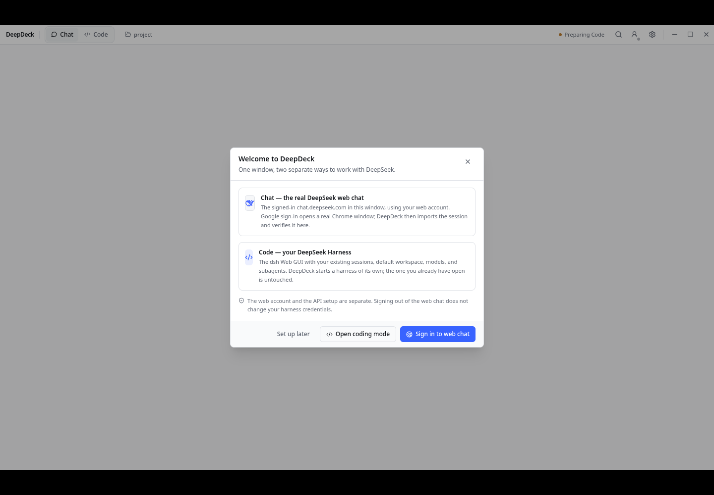

# DeepDeck

**Created by OSINTCabal**

Version **1.0.0**.

A DeepSeek desktop app for **Fedora and Debian Linux**. Use the official web chat and a managed DeepSeek Harness coding workspace in one window.

[Install](docs/INSTALL.md) · [Development](docs/DEVELOPMENT.md) · [Verification](docs/VERIFICATION.md)



## Features

Switch between Chat and Code, choose a local workspace, and manage providers and subagents from Settings. The shell includes search commands, themes, zoom, file selection, account controls, and an isolated API usage page.

The coding workspace uses the harness's own provider catalog and delegation controls. Pending harness updates are validated before activation; a failed candidate keeps the working runtime.

## How it works

1. **Web chat:** The official DeepSeek website opens in a persistent desktop partition. Google sign-in uses Chrome or Chromium, then imports and verifies the resulting chat session.
2. **Coding:** DeepDeck starts a private DeepSeek Harness runtime. Its workspace, configuration, and updates stay separate from another Harness installation.
3. **Local data:** Source belongs in Git. Browser profiles, credentials, runtime bundles, and logs stay outside this checkout. Attaching a file sends only the files you explicitly select.

## Installation

Fedora and Debian use **one repository and the same Electron installer**. Install the packages and Node version listed in the [installation guide](docs/INSTALL.md), then run:

```bash
bash packaging/install.sh
deepdeck
```

Node **24.9 or newer** and npm are required. The first coding setup needs network access. Reinstalling preserves account and coding data. Chrome or Chromium is needed for Google sign-in.

The release verification targets are **Fedora 44 and Debian 13, x86-64**. See the [installation guide](docs/INSTALL.md) for dependencies.

## Screenshots

The clean-profile welcome screen is shown above. Web sign-in and coding setup are separate steps.

## Notes

- DeepSeek web sign-in and API credentials are separate.
- Model access, tool support, billing, and optional coding backends depend on the configured provider and harness release.
- The remote chat page does not receive unrestricted access to local directories.
- DeepDeck is unofficial and is not affiliated with DeepSeek. The source is released under the [MIT license](LICENSE).

## Coming soon

More desktop integration and broader Linux desktop testing are planned.

## Deck series

[VibeDeck](https://github.com/OSINTCabal/VibeDeck) · [GrokDeck](https://github.com/OSINTCabal/GrokDeck) · [KimiDeck](https://github.com/OSINTCabal/KimiDeck) · [MinimaxDeck](https://github.com/OSINTCabal/MinimaxDeck) · [ManusDeck](https://github.com/OSINTCabal/ManusDeck) · [CopilotDeck](https://github.com/OSINTCabal/CopilotDeck) · [JulesDeck](https://github.com/OSINTCabal/JulesDeck) · [MuseDeck](https://github.com/OSINTCabal/MuseDeck) · [ReplitDeck](https://github.com/OSINTCabal/ReplitDeck) · [PerplexityDeck](https://github.com/OSINTCabal/PerplexityDeck)

Part of the OSINTCabal Deck series. [OSINTCabal.org](https://OSINTCabal.org).
